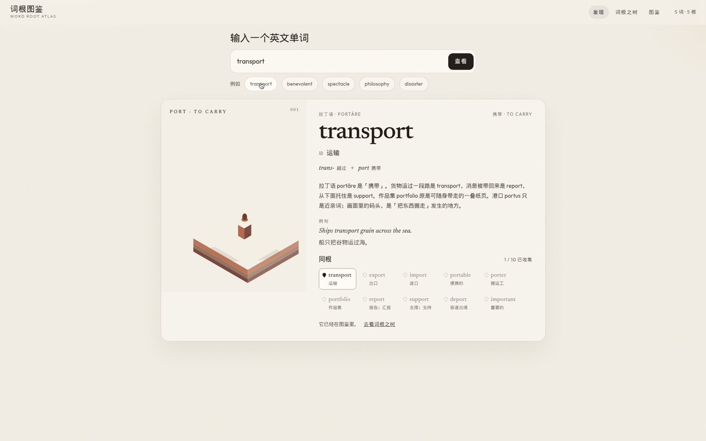
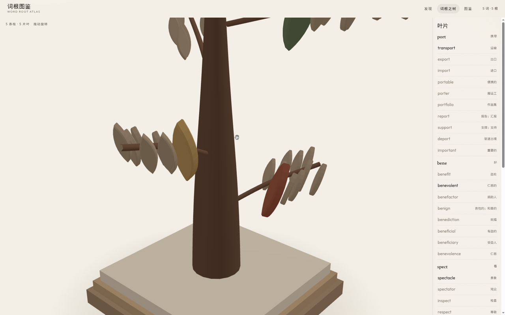
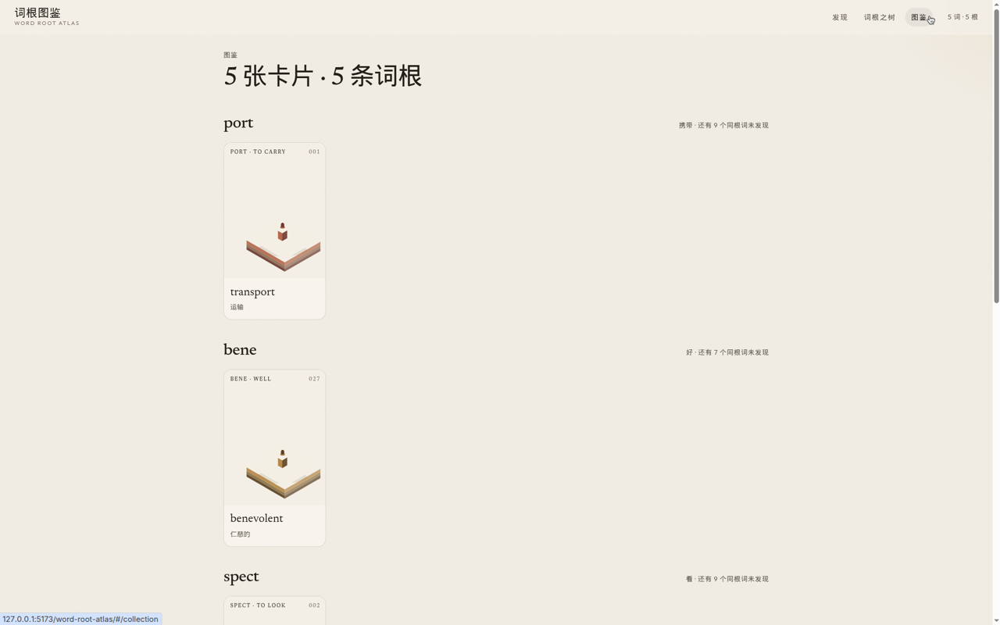
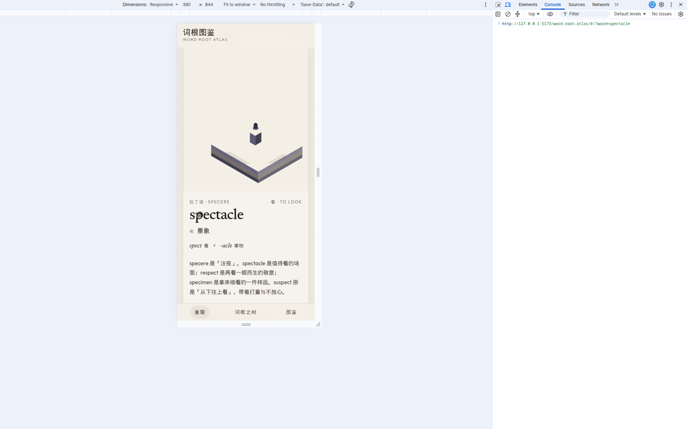

# 词根图鉴 · Word Root Atlas

把英语词汇学成收藏。输入一个单词，看见它的词根、来源和一句靠得住的词源，然后收下一条标本卡片。同一个词根的词，会成为「词根之树」上的叶子。

An open-source, offline vocabulary atlas. Type an English word, learn its root, and keep a museum-like specimen card. Words that share a root grow as leaves on a 3D tree. No account, no server — the collection stays in `localStorage`.

界面是简体中文，单词和词根本身保留英文。

## 样子









## 屏幕

- **发现**：一个输入框。回车或点例子，十秒内能拿到第一张卡片。
- **词根之树**：已收集的词根各成一枝，已收集的词是上色的叶，同根里还没收集的是素坯剪影。拖动旋转，点叶子打开卡片。没有 WebGL 时改为平面标本图。
- **图鉴**：按词根排列的卡片墙。

## 本地运行

```bash
npm install
npm test
npm run dev
```

开发地址是 [http://localhost:5173/word-root-atlas/](http://localhost:5173/word-root-atlas/)（`base` 与 GitHub Pages 一致）。

```bash
npm run build
npm run preview
```

## 插画

每条词根一张 3:4 的微缩场景，放在：

```
public/illustrations/<rootId>.webp
```

例如 `public/illustrations/port.webp`。画面是暖色纸地上的哑光陶土／石膏模型，斜上方 30–45°，主体偏在一侧，左上留白，以便叠上 `PORT · TO CARRY` 这样的标题。场景说明在 [`illustration-prompts.json`](illustration-prompts.json)。图片还没放进来时，卡片会显示同一套调色里的等轴基座，不会出现破图。

插画与代码都按 [MIT](LICENSE) 授权。请只用可再分发的图，不要放有版权的素材。

## 如何增加一条词根

1. 在 `src/data/latin.ts` 或 `src/data/greek.ts` 加一条记录：词根、语言、词典原形、一两句词源（跟得上常见词源书的那种，不要编）、6–12 个同族词。每个词要有中文义、语素拆分、英文例句和中文译文。
2. 在 `illustration-prompts.json` 加 `{ rootId, root, meaning, scene }`。`rootId` 必须和数据里的 `id` 一致。
3. 把 `public/illustrations/<rootId>.webp` 放进去。
4. `npm test`。测试会检查词条数量、词不重复、例句里真的出现这个词，以及提示文件和词根一一对应。

词条写法可以照抄旁边的 `w(...)`：

```ts
w('transport', '运输', '动', [['trans-', '越过'], ['port', '携带']], 'Ships transport grain across the sea.', '船只把谷物运过海。')
```

## 部署到 GitHub Pages

仓库里的 [`.github/workflows/pages.yml`](.github/workflows/pages.yml) 会在 `main` 上构建并发布到 `https://mrzch03.github.io/word-root-atlas/`。

合并之后还需要在 GitHub 里打开一次：

**Settings → Pages → Build and deployment → Source: GitHub Actions**

路由使用 hash（`#/tree`、`#/collection`），不需要额外的 404 回退。

## 技术

Vite、React、TypeScript、three.js / react-three-fiber。词库完全离线。3D 树单独拆包，首屏不加载。
