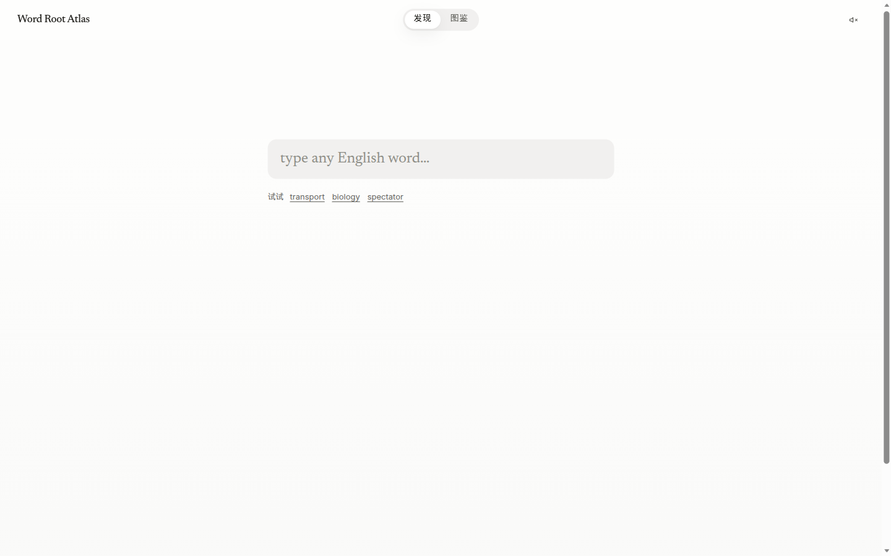
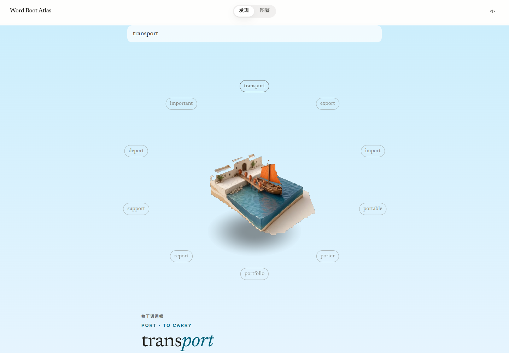
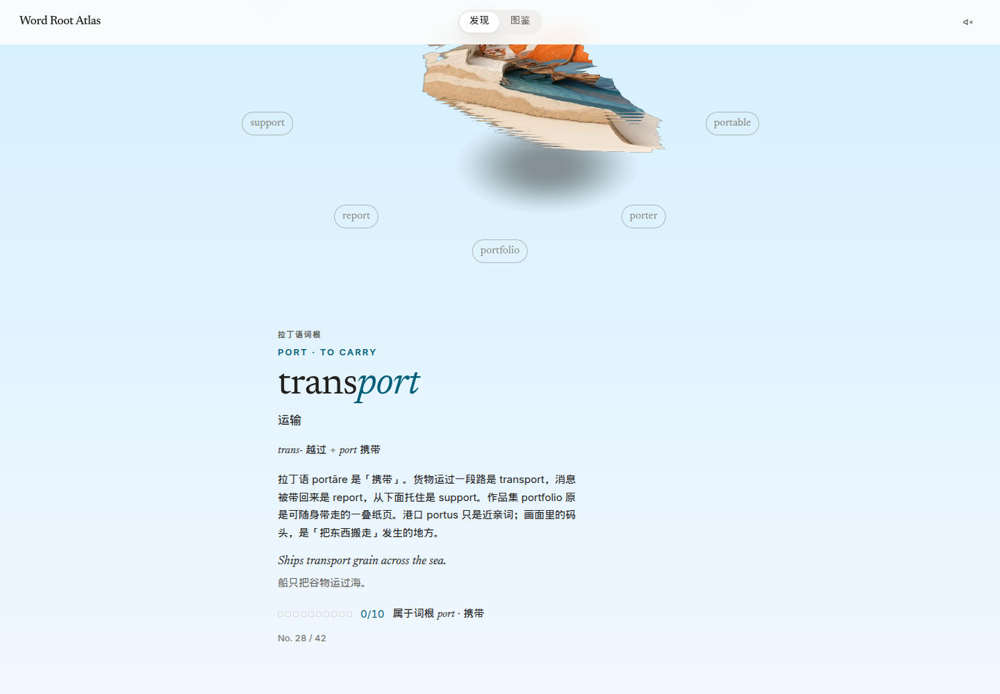
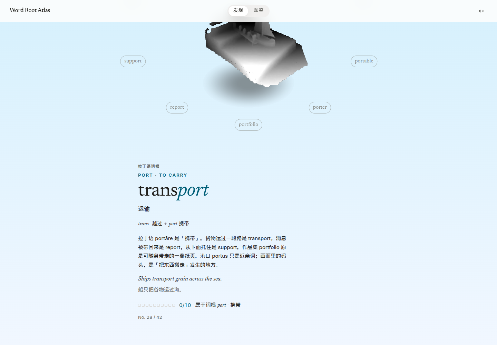
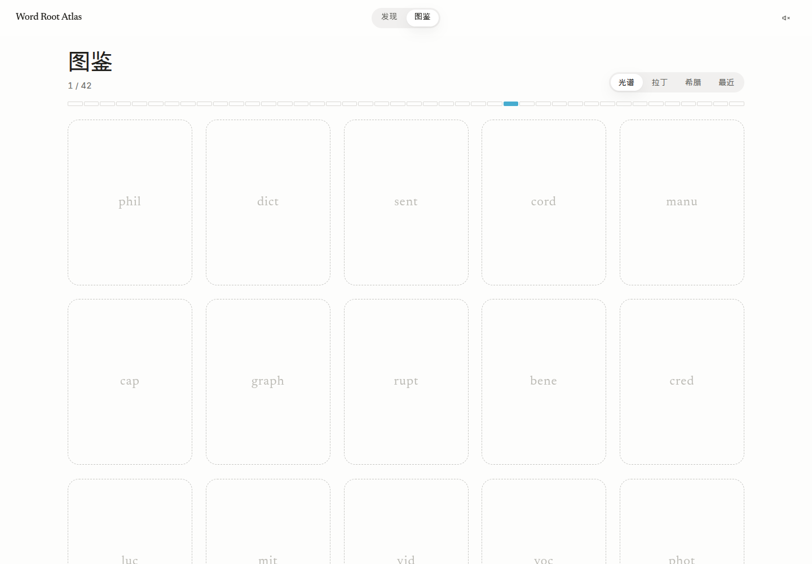
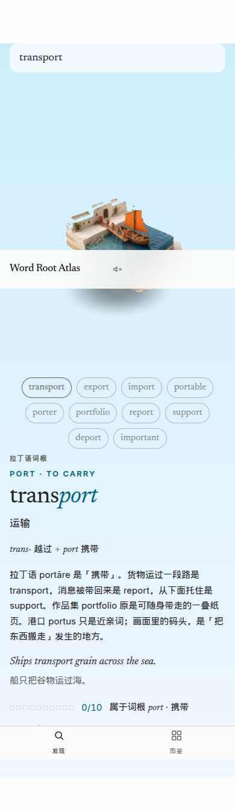

# 词根图鉴 · Word Root Atlas

[](LICENSE)
[](https://mrzch03.github.io/word-root-atlas/)
[](package.json)

把英语词汇学成收藏。输入一个单词，看见它的词根和一句靠得住的词源。第一次遇见一条词根，一张微缩场景从纸面上长出来；之后的同族词，飞进这一家。

An offline vocabulary atlas. Type an English word and keep the root. A new root rises as a small diorama. Later words from the same root join that family. No account, no server — the collection stays in `localStorage`.

界面是简体中文，单词和词根本身保留英文。

## 样子













## 屏幕

- **发现**：空的时候只有搜索。查出一个新词根，场景升起、由灰转彩，页面换成这词根的天色。再查出同族词，标签飞进这一家。
- **卡片**：打开之后是一块可转动的立体模型，大约 ±25° 偏航、±10° 俯仰，松手弹回。图鉴里的缩略图只做很轻的 CSS 倾斜。
- **图鉴**：按色相排成一面墙。收下的是图，还没发现的是空位，不提前露出插画。

## 本地运行

```bash
npm install
npm test
npm run dev
```

开发地址是 [http://localhost:5173/word-root-atlas/](http://localhost:5173/word-root-atlas/)（`base` 与 GitHub Pages 一致）。

```bash
npm run build
npm run preview
```

## 插画和深度

每条词根一张 3:4 的微缩场景：

```
public/illustrations/<rootId>.webp
public/depth/<rootId>.webp
```

深度图是离线生成的。奶油背景和左上角烘进画面的标题会被抠掉，模型才像一件物体。重新生成：

```bash
pip install pillow numpy onnxruntime
python3 scripts/depth_maps.py
```

脚本会下载 Depth Anything V2 Small 的量化 ONNX 到 `scripts/.cache/`（不入库）。场景说明在 [`illustration-prompts.json`](illustration-prompts.json)。

插画与代码都按 [MIT](LICENSE) 授权。

## 如何增加一条词根

1. 在 `src/data/latin.ts` 或 `src/data/greek.ts` 加一条记录：词根、语言、词典原形、一两句词源（跟得上常见词源书的那种，不要编）、6–12 个同族词。每个词要有中文义、语素拆分、英文例句和中文译文。
2. 在 `illustration-prompts.json` 加 `{ rootId, root, meaning, scene }`。`rootId` 必须和数据里的 `id` 一致。
3. 把 `public/illustrations/<rootId>.webp` 放进去，再跑一次 `scripts/depth_maps.py`。
4. `npm test`。测试会检查词条数量、词不重复、例句里真的出现这个词，以及插画、深度图和词根一一对应。

词条写法可以照抄旁边的 `w(...)`：

```ts
w('transport', '运输', '动', [['trans-', '越过'], ['port', '携带']], 'Ships transport grain across the sea.', '船只把谷物运过海。')
```

## 部署到 GitHub Pages

仓库里的 [`.github/workflows/pages.yml`](.github/workflows/pages.yml) 会在 `main` 上构建并发布到 `https://mrzch03.github.io/word-root-atlas/`。

合并之后还需要在 GitHub 里打开一次：

**Settings → Pages → Build and deployment → Source: GitHub Actions**

路由使用 hash（`#/`、`#/collection`），不需要额外的 404 回退。

## 技术

Vite、React、TypeScript。three.js 只在打开卡片时加载，用来把深度图贴到一块细分平面上。词库完全离线。设计过程记在 [`docs/DESIGN-LEARNINGS.md`](docs/DESIGN-LEARNINGS.md)。
